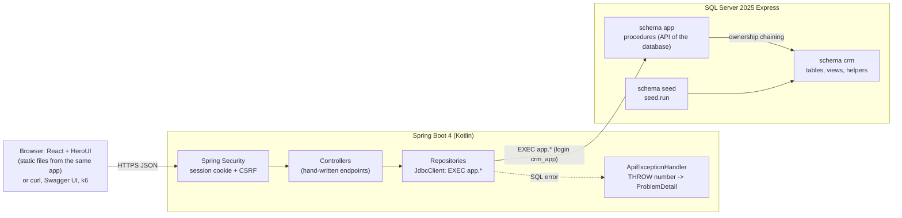
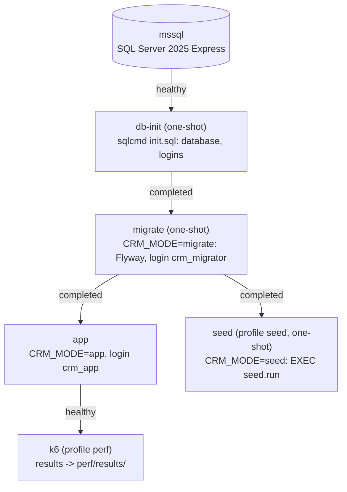
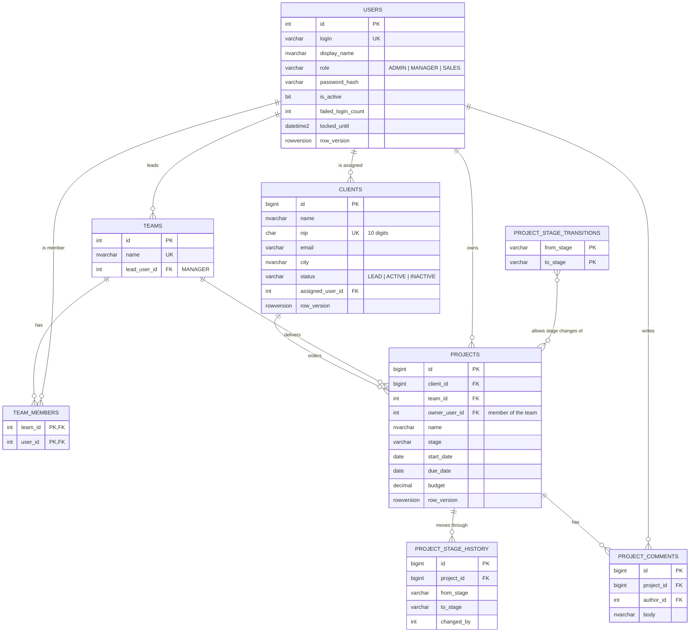
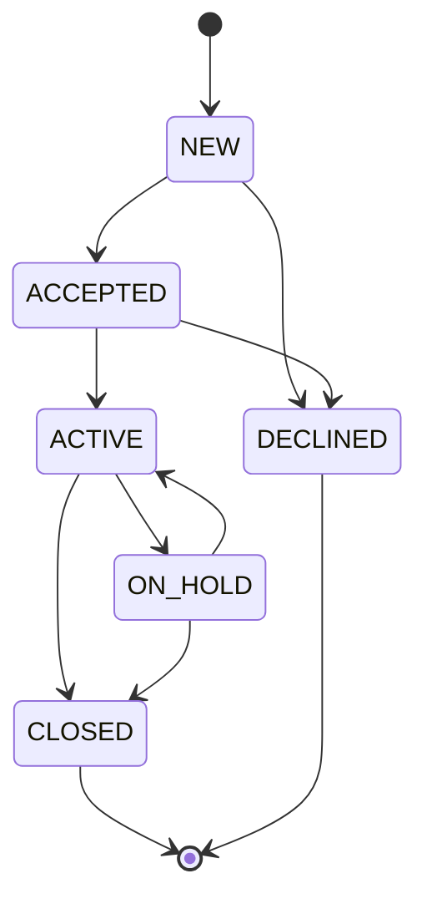
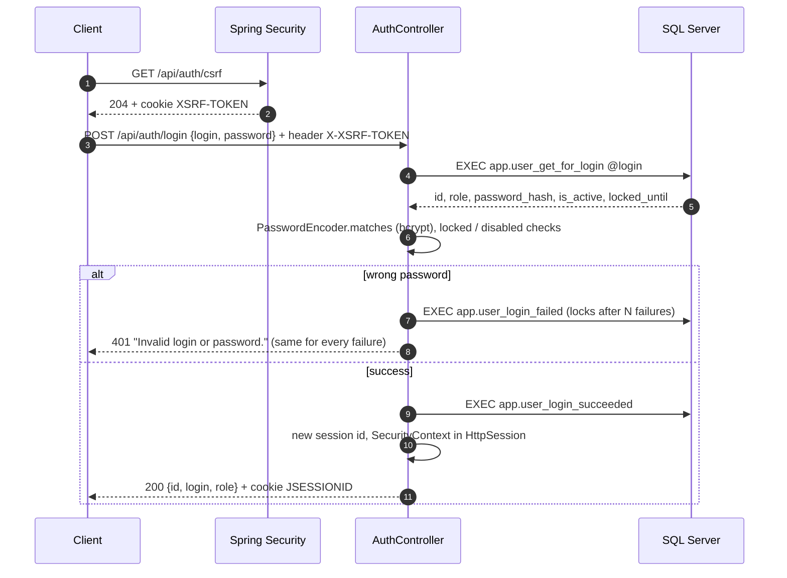
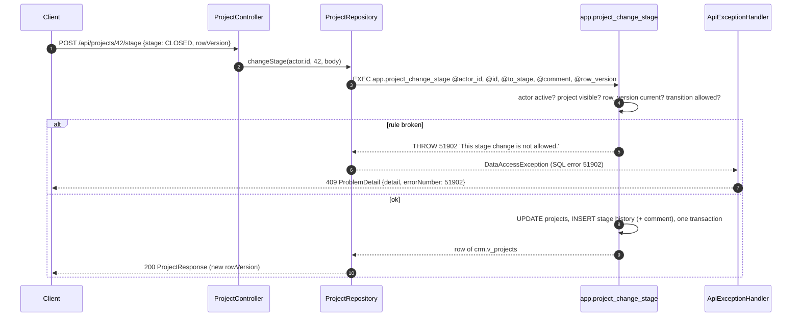
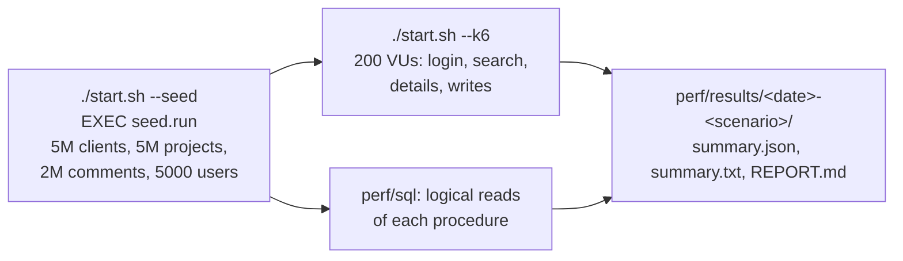

# Diagrams

## Architecture

The application never touches a table. Every call is `EXEC app.<procedure>` over JDBC with a login that has
only `EXECUTE` on schema `app`.

## Containers (docker compose)

## Data model

Read models: `crm.v_projects` (project + client + team + owner, expanded into each query) and the indexed view
`crm.v_team_project_stats` (count and budget per team and stage, read with `WITH (NOEXPAND)`).

## Project stages

The allowed moves are rows of `crm.project_stage_transitions`; `app.project_change_stage` refuses anything else
with error 51902 (HTTP 409).

## Login

## A write with a business error

## Performance test

